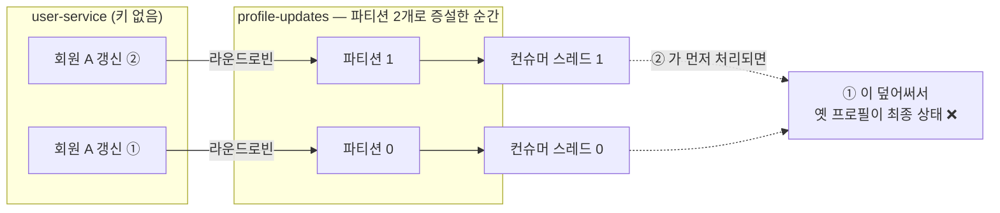
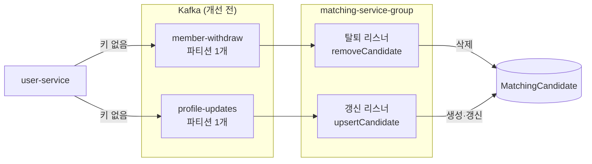
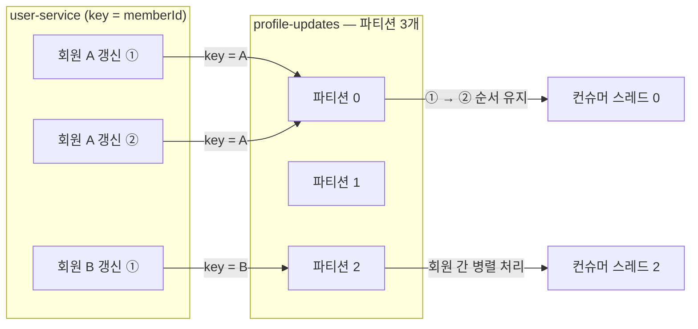
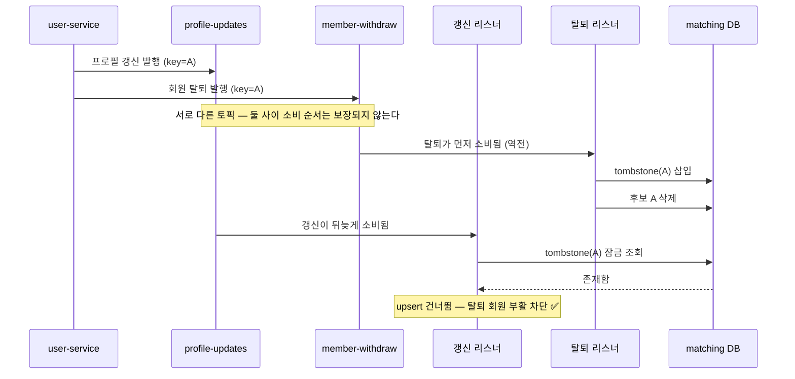

# Kafka 파티션과 메시지 키 개선

> "지금은 안 터지지만 늘리는 순간 터진다" — 파티션 증설의 선행 조건을 갖추고,
> 키로도 막을 수 없는 크로스 토픽 순서 역전까지 닫은 작업의 기록.

## 문제

모든 토픽이 브로커 auto-create 로 만들어져 **파티션 1개**였고, 프로듀서는
**메시지 키 없이** 발행하고 있었다.

```java
kafkaTemplate.send(TOPIC, event);   // key 없음 → 라운드로빈 분배
```

여기서 두 가지가 파생된다.

1. **컨슈머 병렬성이 1로 고정** — 파티션 1개면 컨슈머 그룹당 컨슈머 1개만
   배정된다. concurrency 를 올려도, 인스턴스를 늘려도 나머지는 유휴다.
   처리량 상한이 파티션 수에 묶여 있었다.
2. **파티션을 늘리는 순간 순서가 깨진다** — Kafka 의 순서 보장 단위는 토픽이
   아니라 파티션이다. 키가 없으면 같은 회원의 이벤트가 서로 다른 파티션으로
   흩어져 처리 순서가 뒤집힐 수 있다.

키 없이 파티션만 늘리면 같은 회원의 이벤트가 라운드로빈으로 흩어지고,
파티션이 다르면 처리 순서도 제각각이 된다.



가장 위험한 조합이 `member-withdraw` 와 `profile-updates` 다. 두 토픽 모두
같은 `matching-service-group` 이 소비하고 **같은 `MatchingCandidate` 레코드를
건드린다.**



```text
정상 순서   profile-updates(갱신) → member-withdraw(탈퇴)
            upsertCandidate()    → removeCandidate()      결과: 후보 삭제됨  ✅

역전 발생   member-withdraw(탈퇴) → profile-updates(갱신)
            removeCandidate()    → upsertCandidate()      결과: 탈퇴 회원이 후보로 부활  ❌
```

유실에 강하라고 만든 upsert 가 순서 역전에는 정확히 반대로 작용한다 —
지워진 뒤 도착한 갱신 이벤트가 후보를 다시 만들어 낸다.

## 바꾼 것

### 1. 프로듀서에 메시지 키(memberId) 부여 — 증설의 선행 조건

`UserEventPublisher` 의 세 토픽(`member-signup` · `member-withdraw` ·
`profile-updates`) 전부 `memberId` 를 키로 발행한다.

```java
stringKafkaTemplate.send(topic, String.valueOf(memberId), message);
```

같은 키는 같은 파티션으로 가므로 **회원 단위 순서는 파티션 수와 무관하게
보장되고, 서로 다른 회원끼리는 병렬 처리**된다.



### 2. 토픽 스펙을 코드로 명시 — `KafkaTopicConfig`

`MatchingCandidate` 를 건드리는 두 토픽을 matching-service 에서 `NewTopic`
빈으로 선언했다(파티션 3, 복제 1). 파티션 수는 "얼마나 병렬로 소비해야
하는가"에서 나오고, 그 요구를 아는 쪽은 소비자다.

- `KafkaAdmin` 은 기동 시 기존 토픽의 파티션이 선언보다 적으면 늘려 주고
  줄이지는 못하므로 멱등하게 적용된다.
- 운영 환경(`auto.create.topics.enable=false`)에서 토픽이 없어 발행·구독이
  실패하는 문제도 함께 사라진다.
- 브로커 없는 테스트 환경은 `matching.kafka.topics.enabled=false` 로 토픽
  관리를 끈다(KafkaAdmin 이 기동 시 접속을 시도하며 타임아웃까지 기다리는
  것을 막는다).

### 3. 컨슈머 병렬성 — 설정값 (`matching.kafka.candidate-listener-concurrency`)

두 `@KafkaListener` 의 concurrency 는 설정값이다(기본 3). 처음에는 파티션
수와 같은 상수로 묶었지만, 두 숫자의 성격이 달라서 풀었다. 파티션 수는
늘릴 수만 있는 비가역 결정이라 코드에 박는 게 맞고, concurrency 는 재기동으로
바꿀 수 있는 데다 적정값이 실제 트래픽·인스턴스 수를 본 뒤에야 정해지므로
그 판단을 코드 상수로 미리 닫아 둘 이유가 없다.

조정 범위: 파티션 수(3)를 넘는 값은 유휴 스레드만 만들므로 상한은 3.
줄이는 것은 자유다 — 회원 단위 순서는 "같은 키 = 같은 파티션"이라는
프로듀서 쪽 속성으로 보장되므로 소비 스레드 수를 줄여도 깨지지 않는다.

### 4. 탈퇴 tombstone — 키로는 못 막는 역전을 닫는다

**키의 순서 보장 범위는 한 토픽의 한 파티션이다.** 탈퇴와 갱신은 서로 다른
토픽이므로 키를 걸어도 둘 사이의 순서는 보장되지 않는다(파티션이 1개였던
기존 구조에서도 마찬가지로 존재하던 창이다). 탈퇴가 먼저 처리되고 갱신이
늦게 도착하면 upsert 가 후보를 되살린다.

그래서 삭제를 "레코드 없음"이 아니라 **`WithdrawnMember` 레코드의 존재**로
남긴다.

- `removeCandidate` — tombstone 을 `saveAndFlush` 로 즉시 INSERT 한 뒤 후보를
  **잠금 조회(current read)** 로 지운다. 재전달에 멱등.
- `upsertCandidate` — tombstone 을 잠금 조회하고, 있으면 갱신 이벤트를
  무시한다.



concurrency 3 에서 두 이벤트는 실제로 서로 다른 스레드에서 **동시에** 처리될
수 있고, 이 동시 실행 창은 순서만으로는 닫히지 않는다. 그래서 양쪽 모두
잠금이 필요하다.

- **upsert 쪽**: tombstone 조회가 잠금 조회(`PESSIMISTIC_WRITE`)다. 행이
  없으면 InnoDB 갭 락이 걸려서, 같은 회원의 탈퇴 트랜잭션이 tombstone 을
  넣으려면 upsert 커밋까지 기다려야 한다 — 두 트랜잭션의 직렬화 지점.
- **탈퇴 쪽**: 갭 락 대기가 풀린 뒤의 후보 삭제도 **잠금 조회(current
  read)** 여야 한다. MySQL REPEATABLE READ 에서 일반 조회는 트랜잭션 시작
  시점의 스냅샷을 읽기 때문에, 대기가 풀리는 동안 upsert 가 커밋한 후보를
  보지 못하고 삭제를 건너뛴다. 그러면 tombstone 은 남지만 후보도 남고,
  탈퇴 회원은 이벤트를 더 내지 않으므로 그 후보는 **영구히 매칭 대상으로
  잔존**한다. 잠금 조회는 스냅샷과 무관하게 최신 커밋을 읽어 이 구멍을
  막는다.

#### 토픽 retention — 축제 단발성 서비스에 7일은 과하다

`member-withdraw` · `profile-updates` 의 retention 을 브로커 기본 7일에서
**1일**로 명시했다(`KafkaTopicConfig`, `retention.ms`). 단, "몇 분" 수준까지
줄이지는 않았다. retention 은 저장 비용이 아니라 **컨슈머가 죽어 있어도
되는 최대 시간**이기 때문이다.

발행됐지만 아직 소비되지 않은 메시지는 retention 이 지나면 소비 여부와
무관하게 소거된다. retention 이 컨슈머 다운타임보다 짧으면 그 사이
발행분이 조용히 사라진다 — 재시도도 DLT 도 개입할 기회가 없는, 이번
작업이 없애려던 바로 그 조용한 유실이다.

```text
retention 이 덮어야 하는 창
  배포 다운타임                 수 분
  신규 파티션 배정 지연          최대 5분 (earliest 절 참고)
  차단 재시도 head-of-line      레코드당 최대 7초 × 백로그
  야간 크래시 → 아침 발견        수 시간   ← 하한을 결정
```

밤새 장애를 아침에 발견하는 시나리오까지 덮는 하한이 1일이다.
기존 토픽에도 적용되도록 `KafkaAdmin.setModifyTopicConfigs(true)` 를 켰다
(NewTopic 에 선언한 config 만 비교·수정하므로 다른 설정에는 무해).
`.DLT` 토픽은 사람이 열어 보고 재처리하는 곳이라 줄이지 않는다(기본 7일).

#### 탈퇴 표식과 프로필 버전

매칭은 탈퇴 회원 ID를 기본 2일간 `withdrawn_member`에 보관한다. 표식이 남아 있으면
늦게 도착한 프로필 이벤트를 무시한다. 새벽 04시 정리 후에도 outbox나 DLT에서 지난 이벤트가 올 수 있다.
후보가 없는 경우에는 회원 서비스의 내부 API에서 상태와 최신 프로필을 확인한 뒤 후보를 생성한다.
조회 중 탈퇴나 새 프로필이 먼저 처리될 수 있어, 응답 반영 직전에 다시 표식과 버전을 잠금 조회한다.

회원 서비스는 프로필 생성·수정 트랜잭션에서 `profileVersion`을 올리고 그 버전의 JSON을
outbox에 저장한다. 매칭은 원본과 전용 replay 모두에서 이미 반영한 버전 이하를 건너뛴다.
버전 없는 예전 메시지나 버전 0인 기존 후보는 원본 DB의 현재 정보로 재동기화한다.
회원 서비스 조회 실패는 Kafka 재시도와 그룹별 DLT로 전달된다.

### 5. `auto.offset.reset=earliest` — 증설이 유실이 되지 않게

공통 컨슈머 팩토리는 yml 의 `spring.kafka.consumer.*` 를 읽지 않는 수동
구성이라, yml 에 뭐라고 적어도 실제로는 클라이언트 기본값 **latest** 가
적용되고 있었다. latest 는 파티션 증설과 만나는 순간 유실이 된다.

```text
증설 직후 새 파티션(p1, p2)에는 어떤 그룹의 커밋 오프셋도 없다
   → 프로듀서는 메타데이터 갱신 즉시 새 파티션으로 발행 시작
   → 컨슈머 그룹은 메타데이터 갱신(최대 5분) 후에야 새 파티션을 배정받음
   → latest: 배정 시점에 로그 끝으로 점프 → 그 사이 발행분 영구 유실
```

`member-withdraw` 는 notification 도 구독하므로 탈퇴 메일이 소리 없이
누락되고, matching 쪽은 tombstone 미기록·후보 미삭제로 이어진다. 팩토리에
`earliest` 를 명시했다 — 커밋 오프셋이 있는 기존 파티션에는 아무 영향이
없고, 오프셋이 없는 새 파티션만 처음부터 읽는다.

## 전환 절차 — 증설은 배포 순서가 반이다

키 지정(프로듀서, user-service)과 파티션 증설(`KafkaAdmin`, matching-service)
은 서로 다른 서비스에서 일어난다. 순서가 뒤집히면 키 없는 프로듀서가 3개
파티션에 이벤트를 뿌리는 구간이 생긴다.

```text
① user-service 배포        키 지정. 파티션이 아직 1개라 동작 변화 없음(무해)
② 컨슈머 lag 드레인 확인    p0 에 쌓인 백로그를 소진
③ matching-service 배포     KafkaAdmin 이 파티션 1 → 3 증설
```

이 순서대로 해도 전환 구간에는 한계가 남는다. 기존 백로그는 전부 p0 에
있고 새 메시지는 p1·p2 로 흩어지는데, 파티션별 소비 속도가 다르므로 **같은
회원의 옛 이벤트(p0)가 새 이벤트(p2)보다 늦게 처리될 수 있다.**
이때도 매칭은 프로필 버전을 비교한다. 버전이 없는 이전 형식은 회원 서비스에서 다시 읽는다.

## 재시도와 DLT — 유실을 눈에 보이게

순서를 지켜도 **이벤트가 사라지면 소용이 없다.** tombstone은 역전을 막을 뿐
유실은 못 막는다. 실패했을 때의 결과가 컨슈머마다 달랐던 것부터 정리했다.

```text
개선 전
  탈퇴 컨슈머      catch (Exception e) { log.error(...) }   ← 1회 실패 = 즉시 유실
  채팅방 컨슈머    catch (Exception e) { throw e; }         ← 간격 0으로 10번 → 포기
  나머지           예외 전파                                 ← 위와 동일
```

예외를 삼키면 오프셋이 그대로 커밋되어 **재시도도 DLT도 없이** 탈퇴가 사라지고,
후보 테이블에 탈퇴 회원이 영구히 남는다. 그래서 삼킴을 먼저 걷어냈다 —
이걸 두면 에러 핸들러가 예외를 볼 기회가 없어 DLT를 붙여도 무용지물이다.

### 왜 차단(blocking) 재시도인가

`@RetryableTopic`(비차단)은 실패한 레코드를 별도 재시도 토픽으로 보내고 원래
파티션은 곧바로 다음 레코드를 처리한다. **그러면 앞의 모든 작업이 무너진다.**

```text
비차단 재시도
  갱신① 처리 실패 → 재시도 토픽으로 이동
  갱신② 즉시 처리 → 최신 프로필 반영
  5초 뒤 갱신① 재시도 성공 → 갱신②를 덮어씀
  결과: 메시지 키로 만든 파티션 내 순서 보장이 재시도 경로에서만 깨짐 ❌
```

차단 방식은 그 자리에서 멈추고 다시 시도하므로 순서가 유지된다. 대가는 재시도
동안 그 파티션이 멈추는 것(head-of-line blocking)이라, **총합을 7초**
(1초 → 2초 → 4초, 최초 1회 + 재시도 3회)로 묶었다.
재시도 총합이 `max.poll.interval.ms`(기본 5분)를 넘으면 브로커가 컨슈머를 죽은
것으로 보고 리밸런스를 일으켜 문제가 더 커지기 때문이다.

### 무엇을 재시도에서 빼는가

역직렬화·타입 변환 실패는 재시도 대상이 아니다(`DefaultErrorHandler` 기본값).
같은 바이트를 다시 읽어도 결과가 같으므로 7초를 낭비할 이유가 없다.

반면 **업무 예외는 일부러 재시도 대상으로 남겼다.** Feign 호출 실패 같은
일시적 원인이 `BusinessException`으로 감싸여 올라오는 경로가 있어서, 재시도
제외로 분류하면 회복할 수 있는 실패까지 DLT로 보내게 된다. 잘못 분류했을 때의
손해가 7초 지연보다 크다.

### 함께 닫은 구멍 두 개

- **poison pill** — `JsonDeserializer`를 그대로 쓰면 역직렬화 실패가 poll
  단계에서 터진다. 그 단계에는 에러 핸들러가 개입할 수 없어 오프셋이 넘어가지
  못하고 **같은 레코드를 무한히 다시 읽는다.** 깨진 메시지 하나가 파티션을
  영구히 막는 것이다. `ErrorHandlingDeserializer`로 감싸 리스너 단계의 예외로
  바꿨다.
- **DLT 파티션 불일치** — `DeadLetterPublishingRecoverer`는 기본적으로 원본과
  같은 파티션 번호로 보낸다. 원본이 3파티션인데 DLT가 1파티션이면 "2번
  파티션으로 보내라"가 실패해서, **유실을 막으려고 만든 장치가 유실 지점이
  된다.** 파티션을 -1로 넘겨 프로듀서가 키로 고르게 했다.

DLT 토픽 스펙도 코드에 박았다(`comatching.kafka.dlt-topics`). 운영 환경은
auto-create가 꺼져 있어 DLT 토픽이 없으면 옮길 곳 자체가 없기 때문이다.

### DLT 적재 알림

DLT에 보관된 레코드는 토픽 보존 기간 안에 확인해 실패 원인을 고치고 재처리한다.

`DeadLetterPublishingRecoverer` 를 감싸 **DLT 발행이 성공한 직후** 웹훅으로
알린다(`KafkaDltAlertNotifier`, `comatching.kafka.dlt-alert-webhook-url`).
본문에 `{"content", "text"}` 두 키를 같이 실어 Discord·Slack 어느 웹훅
URL 을 줘도 동작한다. 설계 결정들:

- **Prometheus + Alertmanager 가 아닌 이유** — 현재 모니터링 스택은 부하
  테스트 때만 띄우는 구성이라 상시 알림의 기반이 못 되고, 알림 하나를 위해
  Alertmanager·kafka-exporter 를 상시 운영에 추가하는 것은 단발성 서비스에
  과하다. 발행 시점 알림은 어느 메시지가 왜 실패했는지까지 본문에 실린다.
- **경로별 DLT 쿨다운(기본 5분)** — poison pill 뒤 백로그가 연쇄로 DLT 에
  떨어지면 웹훅이 도배되고, rate limit 에 걸리면 정작 다른 토픽의 알림까지
  막힌다. 억제된 건수는 다음 알림에 합산 보고한다.
- **전송 실패는 삼킨다** — 알림 장애가 소비 흐름(오프셋 진행)을 막으면
  주객전도다. 웹훅과 무관하게 적재는 항상 `log.error` 로 남는다.
- **발행 성공 후에만 알린다** — DLT 발행 자체가 실패하면 recoverer 예외가
  에러 핸들러로 전파되어 다시 다뤄지므로, 그 시점 알림은 이르다.

### 프로필 DLT 재처리

실패 원인을 고친 뒤 matching-service의 내부 API를 호출한다.

```bash
curl -X POST -H "X-Internal-Token: $TOKEN" \
  "http://<matching-service>/api/internal/kafka/dlt/redrive?route=CANDIDATE_PROFILE"
```

`KafkaDltRedriveService`는 시작 시점까지의 그룹별 DLT 레코드를 같은 그룹 전용 replay 토픽에
보내고, Kafka의 쓰기 확인 후 각 레코드의 DLT 오프셋을 커밋한다. API의 `redriven`은 replay에
발행한 수다. 매칭 DB 반영 또는 이전 버전 건너뛰기는 리스너가 수행한다. 실패하면 같은 경로의 DLT로 돌아간다.

재처리 도중 프로세스가 종료되면 같은 레코드를 다시 보낼 수 있다. 프로필 리스너는 적용한
버전을 비교한다. 재발행 시에는 실패 진단 헤더를 제거하고 원래 key·JSON·업무 헤더를 보존한다.
서비스의 `comatching.kafka.dlt-routes`에 선언된 경로만 재처리할 수 있다.

유지보수 중 전환 순서는 기존 소비 중단 → `db/migrations/20261119_02_profile_versions.sql`
적용 → 새 user-service의 모든 인스턴스 기동 → 새 matching-service 기동 → 수동 replay 재개다.
복구용 `GET /api/internal/users/{memberId}/matching-profile`도 기존 내부 토큰을 사용한다.
기존 outbox·원본·DLT의 JSON은 수정할 필요가 없다.

## 검증

| 테스트 | 방식 | 결과 |
|---|---|---|
| 같은 회원의 이벤트가 memberId 키로 같은 파티션에 발행 순서대로 쌓인다 | EmbeddedKafka, 3파티션 토픽에 실제 발행 후 키·파티션·오프셋 확인 (`UserEventPublisherIT`) | ✅ |
| 정상 순서: 갱신 → 탈퇴 ⇒ 후보 삭제 + tombstone | 실제 MySQL (Testcontainers, `CandidateServiceImplIT`) | ✅ |
| 역전 순서: 탈퇴 → 늦은 갱신 ⇒ 후보 부활하지 않음 | 〃 | ✅ |
| 탈퇴 이벤트 재전달·후보 없는 탈퇴 ⇒ 멱등 | 〃 | ✅ |
| 탈퇴하지 않은 회원의 upsert 는 그대로 동작 (신규 + 갱신) | 〃 | ✅ |
| **동시 실행**: upsert 가 갭 락을 잡고 진행 중일 때 탈퇴가 끼어들어도 후보가 남지 않음 | 실제 MySQL, 두 스레드·두 트랜잭션으로 교차 재현 | ✅ |
| TTL 경과 tombstone 만 삭제되고 보존 기간 내 행은 남는다 | 실제 MySQL (`WithdrawnMemberCleanupSchedulerIT`) | ✅ |
| 계속 실패하는 메시지가 재시도 4회(최초 1 + 3) 후 `.DLT` 로 옮겨지고, 원본 키·위치 헤더가 보존됨 | EmbeddedKafka, 실제 실패 리스너 (`KafkaRetryAndDltIT`) | ✅ |
| 일시적 실패는 재시도로 회복되고 DLT 로 가지 않음 | 〃 | ✅ |
| DLT 이동 시에만 알림 발화, 회복된 실패는 알리지 않음 | 〃 | ✅ |
| 쿨다운 억제·억제 건수 합산 보고·토픽별 독립·미설정 시 no-op | 시계 주입 단위 테스트 (`KafkaDltAlertNotifierTest`) | ✅ |
| 원인 수정 후 재적재하면 평소 소비 경로로 재처리되고 키가 보존됨 | EmbeddedKafka, 적재→수정→재적재 전체 사이클 (`KafkaDltRedriveIT`) | ✅ |
| 재적재는 커밋 오프셋을 남겨 중복 재적재하지 않고, 미선언 토픽은 거부함 | 〃 | ✅ |

user-service · matching-service 전체 테스트 회귀 통과 (failures 0, errors 0).
구현 후 별도의 다각도 검증(Kafka 의미론·JPA 잠금·운영 설정)을 거쳐 발견된
스냅샷 읽기 구멍(동시 실행 시 후보 미삭제)과 latest 유실 창을 반영했다.

## 프로필 replay 이후 남은 Kafka 작업

회원 이벤트와 매칭 성공 이벤트는 outbox를 사용한다. 그룹별 DLT·전용 replay, FCM 실패 분류와 재시도, 프로필 버전 비교, 세 서비스의 발행 완료 행 7일 정리는 구현했다. 매칭 리스너 두 개는 같은 그룹과 CooperativeStickyAssignor를 사용하고, 탈퇴 메일은 기존처럼 스레드 하나에서 처리한다.

| 순서 | 남은 작업 | 완료 기준 |
|---|---|---|
| 1 (완료) | **결제 승인과 아이템 지급 상태 분리** | 승인과 지급 예약을 함께 기록한다. DB 워커가 주문 구성품 전체의 원장·재고·이력을 한 트랜잭션에서 지급하고 `GRANTED`로 전환한다. 실패 시 승인은 보존하고 관리자 API로 지급만 재시도한다. |
| 2 (완료) | **아이템 지급 완료 이벤트를 outbox에서 Kafka로 발행** | DB 워커가 묶음 전체를 지급할 때 원장·재고·이력·`GRANTED`와 주문당 `ItemsGranted` outbox 한 행을 함께 커밋한다. 발행기는 `items-granted` 토픽에 `orderId`를 키로 전송하고 재전송 시 최초 `eventId`를 유지한다. |
| 3 (완료) | **지급 완료 메일과 푸시 연결** | 두 그룹이 같은 지급 완료 토픽을 읽고 채널별로 발송을 선점한다. 메일만 실패하면 메일 DLT에서 메일 replay로 재전송한다. |
| 4 (완료) | **가입·탈퇴 메일로 소비자별 중복 방지 확대** | 가입 메일과 탈퇴 메일이 각각 기존 발송 원장에 결과를 기록한다. 같은 이벤트가 원본이나 전용 replay로 다시 와도 이미 수락된 메일은 건너뛴다. |
| 5 (완료) | **채팅 메시지 푸시 outbox** | 채팅 메시지와 발행 대기 정보를 MongoDB 한 문서에 저장한다. 워커는 `roomId` 키로 Kafka에 발행하고, 알림 서비스는 메시지별 발송 원장과 수신자의 현재 읽음·차단 상태를 확인한다. |

운영 재개 시에는 아래 순서로 확인한다.

1. 서비스 배포 전에 대상 DB에 회원·매칭·지급 outbox, 프로필 버전, 지급 상태 분리 및 알림 발송 원장 스키마와 권한을 준비한다. 기존 주문 중 `REVIEW_REQUIRED` 건은 원장과 재고 이력을 대조한다. 지급 메일에 필요한 user-service 내부 이메일 조회 API와 Kafka 토픽을 먼저 준비하고 notification을 기동한다.
2. 예전 공용 DLT의 미처리 레코드는 원본 토픽, 실패한 소비 그룹, 업무 처리 이력을 대조한다. 실패 그룹이 확인된 건만 해당 그룹의 replay로 보낸다. 예를 들어 가입 메일만 실패한 건을 메일 replay로 보내면 아이템 그룹에는 전달되지 않는다. 그룹을 식별할 수 없는 기록은 수동 확인 대상으로 둔다.
3. 기존 매칭 소비자를 멈춘 시점의 `matching-service-group` 커밋 오프셋을 토픽·파티션별로 기록하고 새 `matching-candidate-sync-group`의 위치 및 브로커 보존 범위와 대조한다. 새 그룹에 오프셋이 없으면 현재 `earliest` 설정이 적용된다. 명시적인 시작 위치를 설정할 때는 소비자를 중지한 상태에서 준비한다. 기존 위치가 이미 보존 범위 밖이면 DB 대조와 복구 범위를 먼저 정한다.

### 2번 설계 결정 · 묶음 지급이 끝난 뒤 Kafka로 알린다

운영자가 입금을 확인하면 주문은 `APPROVED`, 지급은 `PENDING`이 된다. 이 기록으로 기존 DB 워커가 지급을 시작할 수 있다. 고객에게 메일과 푸시로 알리고 싶은 사실은 “구매한 아이템을 지금 쓸 수 있다”는 것이다. 그래서 Kafka 발행의 기준을 묶음 전체의 지급 완료로 정했다.

| 처리 주체 | 시작 조건 | 결과 |
|---|---|---|
| item-service의 DB 워커 | `APPROVED / PENDING` 주문 | 원장·재고·이력과 `GRANTED` 상태를 쓰고 같은 트랜잭션에 `order_grant_outbox_events` 한 행을 저장한다. |
| notification의 지급 완료 메일 그룹 | Kafka에서 `ItemsGranted` 수신 | 내부 회원 API로 수신 주소를 조회해 지급 품목과 수량을 메일로 보낸다. |
| notification의 지급 완료 푸시 그룹 | Kafka에서 같은 `ItemsGranted` 수신 | 회원의 FCM 토큰으로 지급 완료 푸시를 보낸다. |

예를 들어 메일 서버가 10분간 중단돼도 푸시 그룹은 같은 지급 완료 이벤트를 읽고 알림을 보낼 수 있다. 메일 그룹은 장애가 풀리면 보관 기간 안에서 자기 처리 위치부터 이어간다. 각 그룹의 처리 이력과 복구 경로도 따로 관리한다. [Apache Kafka의 컨슈머 그룹 설명](https://kafka.apache.org/39/javadoc/org/apache/kafka/clients/consumer/KafkaConsumer.html)

지급에 실패하면 outbox도 함께 롤백된다. 관리자 재시도로 지급에 성공하면 그때 발행할 행이 생긴다. Kafka 장애 중에도 지급은 커밋되고, 발행기는 복구 후 저장된 이벤트를 전송한다. 기존 주문 outbox는 관리자 WebSocket 전송 결과를 관리한다. 지급 완료 outbox의 `PUBLISHED`는 Kafka가 수신을 확인했다는 뜻이며 메일·푸시의 실제 발송 결과는 각 소비자가 관리한다. 브로커 수신 직후 발행기가 종료되면 같은 이벤트가 재전송될 수 있다.

### 지급 완료 알림 복구

`comatching_notification.notification_delivery`의 기본키는 `(event_id, handler_id)`다. 예를 들어 `items-granted:123`에는 `GRANT_MAIL`과 `GRANT_PUSH` 두 행이 생긴다. 이 원장은 outbox 7일 정리 대상에서 제외한다. 오래된 DLT를 복구할 때도 기존 발송 이력이 필요하다.

| 상태 | 같은 이벤트를 다시 받았을 때 |
|---|---|
| `SENT` / `SKIPPED` | 수락 확인 또는 수신 대상 없음으로 종료된 채널이므로 건너뛴다. |
| `RETRYABLE` | 해당 채널이 새 시도 번호로 선점할 수 있다. 원인을 고친 뒤 notification 내부 redrive API의 `route=ITEMS_GRANTED_MAIL` 또는 `route=ITEMS_GRANTED_PUSH`를 사용한다. |
| `UNKNOWN` / 처리 도중 남은 `SENDING` | replay에서도 외부 전송을 보류한다. 원 시도가 끝났는지 먼저 확인하고 제공자 기록과 대조한다. 수락이 확인되면 `SENT`, 미발송이 확인되면 `RETRYABLE`로 조정한다. 조정 시 이벤트 ID·채널·시도 ID·기존 상태를 모두 조건으로 사용한다. 확인할 수 없으면 보류한다. |

### 가입·탈퇴 메일 복구

회원 42의 가입 이벤트에는 `member-signup:42`, 탈퇴 이벤트에는 `member-withdraw:42`가 outbox JSON에 저장된다. Kafka 키는 두 경우 모두 `42`다. 알림 서비스는 가입을 `SIGNUP_MAIL`, 탈퇴를 `WITHDRAW_MAIL`로 선점하므로 가입 메일을 이미 보냈어도 탈퇴 메일은 보낼 수 있다. 탈퇴 메일은 탈퇴 이벤트에 담긴 당시 이메일 주소를 사용한다.

예전 JSON에 `eventId`가 없어도 회원 ID와 이벤트 종류로 같은 ID를 얻는다. 메일 작성이나 SMTP 인증 단계에서 실패하면 `RETRYABLE`로 기록하고, 재시도 소진 후에는 해당 그룹의 DLT에 보관한다. 복구할 때는 `SIGNUP_MAIL` 또는 `WITHDRAW_MAIL` 경로를 사용한다. SMTP 수락 여부가 불명확한 `UNKNOWN`과 전송 중 남은 `SENDING`은 위 표와 같이 제공자 기록을 확인한다.

운영 전환 후에는 가입·탈퇴 메일을 소비하는 모든 notification 인스턴스가 새 버전인지 확인한다. 이전 버전이 보낸 메일은 원장에 기록이 없다. 전환 전 DLT나 과거 오프셋을 재생할 때는 먼저 SMTP 발송 기록과 대조하고, 미발송이 확인된 건만 다시 보낸다.

### 채팅 푸시 복구

차단되지 않은 수신자에게 보내는 `TALK`·`IMAGE` 메시지는 `chat_messages.pushOutbox`에 `PENDING`을 함께 기록한다. 워커는 발행할 시간이 된 문서를 선점하고 Kafka의 수신 확인 후 `PUBLISHED`로 바꾼다. 전송 실패 시 30초 뒤 다시 시도한다. 워커가 종료되면 120초의 선점 기한이 지난 작업을 다른 워커가 이어받는다. 발행이 끝나면 대기 인덱스에서 빠지며 채팅 기록은 보존된다.

Kafka 수신 직후 워커가 종료되면 같은 메시지가 다시 발행될 수 있다. 알림 서비스는 `(chat-message:{messageId}, CHAT_PUSH)` 원장으로 발송을 선점한다. FCM 호출 직전에 chat-service에서 마지막 읽음 시각과 차단 여부를 확인한다. 이미 읽었거나 차단했으면 `SKIPPED`, 조회 장애면 `RETRYABLE`이다. FCM 수락 여부가 불명확한 `UNKNOWN`이나 발송 중 남은 `SENDING`은 replay해도 자동 재발송하지 않는다.

배포 전에는 구형 발행을 멈추고 기존 소비자가 처리하던 대기 건을 확인한다. 새 chat 내부 API와 새 notification 소비자가 준비된 뒤 채팅 쓰기를 재개한다. 기존 MongoDB 메시지는 소급 발행하지 않는다. Kafka에 남은 구형 이벤트는 `messageId`가 없어 채팅 알림 그룹의 DLT로 보낸다. 구형 레코드는 그대로 replay해도 ID가 생기지 않으므로 발송 이력을 대조한다.

### 고객에게 언제 알려줄까 (권장안)

정상 주문은 지급이 완료된 후 메일과 푸시를 보낸다. 지연 안내를 시작할 시간은 미정이다. 수동 환불 시작·완료 API와 환불 완료 메일은 구현됐다. [관리자 환불 화면 과제](docs/frontend_tasks/admin-order-refunds.md)에 버튼과 상태별 표시 기준이 있다.

| 상황 | 운영자와 고객에게 할 일 |
|---|---|
| 첫 지급 시도 실패 | 입금 승인은 유지된다. 운영자가 실패 주문을 확인하고 같은 주문의 지급만 재시도한다. 이 시점에 고객에게 별도의 실패 메일을 보내면 재시도 성공 후 완료 메일까지 받게 된다. |
| 재시도로 정상 지급 | 최초 시도에 성공한 주문과 동일하게 하나의 지급 완료 이벤트로 메일·푸시를 각각 발송 대상으로 기록한다. |
| 고객에게 안내한 지급 시간을 넘김 | 발송 직전에 여전히 미지급인지 확인한 뒤 주문당 한 번 “입금은 확인했고 지급이 늦어지고 있습니다”라고 안내한다. 고객이 다시 입금할 필요가 없다는 점과 문의 경로를 포함한다. 안내 기준 시간은 운영팀이 실제 대응 가능한 시간에 맞춰 정한다. |
| 운영자가 지급을 중단하고 환불하기로 결정 | `APPROVED / FAILED / NONE`이고 지급 원장과 지급 완료 이벤트 기록이 없는 주문만 `IN_PROGRESS`로 전환한다. 주문 행 잠금과 지급 재시도의 조건부 갱신으로 같은 시도에서 두 작업을 동시에 시작할 수 없다. |
| 수동 계좌이체로 환불 완료 | 운영자가 실제 이체를 마친 후 완료하면 `COMPLETED`와 `refund-completed:{orderId}` 이벤트가 함께 커밋된다. 환불 메일 전용 그룹이 주문 번호·환불액을 메일로 보내며 기존 발송 원장의 `REFUND_MAIL` 처리 이력으로 재발송을 제어한다. |

현재 `FAILED`는 해당 지급 시도의 실패를 뜻한다. 환불 시작 전에는 관리자 재시도 API가 이를 다시 `PENDING`으로 바꾼다. 예를 들어 재고 락 경합이나 DB 쓰기 장애는 해소된 뒤 재시도할 수 있고, 구성품 누락·원장 충돌은 데이터 대조가 먼저다. 워커가 정지하면 `PENDING`에서도 대기할 수 있으므로 고객 지연 안내는 승인 이후 경과 시간과 실제 미지급 여부를 함께 봐야 한다. [관리자 화면 연결](docs/frontend_tasks/admin-failed-grants.md)과 지연 안내 기준 확정이 남았다.

지급 완료 판단의 기준은 주문 DB의 `grant_status=GRANTED`다. 회원이 아이템을 사용하면 현재 재고는 줄어들어도 주문의 지급 사실은 유지된다. 확인이 필요하면 해당 주문 ID와 품목 ID의 지급 원장을 대조한다. Kafka 장애는 outbox 발행기가 자동 재시도하며, 이미 커밋된 지급을 다시 실행하지 않는다.
